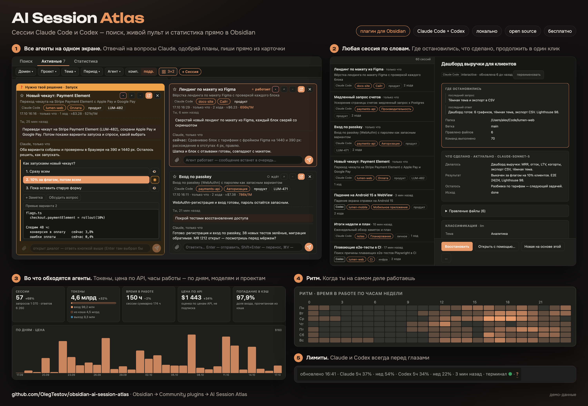

# AI Session Atlas

**[Установить из каталога плагинов Obsidian](https://community.obsidian.md/plugins/session-atlas)** · [English version](README.md)

AI Session Atlas — плагин Obsidian для macOS для тех, кто каждый день работает с Claude Code и
Codex. Он собирает транскрипты сессий обоих агентов (`~/.claude/projects` и `~/.codex/sessions` у
Codex) в один каталог с поиском, показывает запущенные сессии живыми карточками, на которые можно
отвечать, считает токены и цену и запускает Claude Code и Codex во вкладках терминала внутри
Obsidian — после перезапуска вкладка открывает ту же сессию. Всё работает локально: плагин запускает
небольшой сервер на Python на `127.0.0.1` и ничего никуда не отправляет, пока ты не включишь
ИИ-функции.



## Возможности

- **Поиск.** Полнотекстовый поиск по всем сессиям Claude Code и Codex: твои запросы, ответы,
  команды оболочки и изменённые файлы. Фильтры по агенту, проекту, направлению, теме и дате. В карточке
  сессии — цена, изменённые файлы и раскрываемая **Лента сессии** с вопросами и ответами агента,
  в том же виде, что в «Активных». Сначала загружаются последние 20 запросов; прокрути вверх для более
  ранних. Для длинных сообщений действуют те же ограничения превью, что в «Активных». В карточке есть кнопки:
  - **Продолжить** сессию во вкладке терминала Obsidian (`claude --resume` или `codex resume`);
  - продолжить её в другом агенте через **Открыть с помощью…**: сессию Claude Code — в Codex, сессию
    Codex — в Claude Code (см. ниже);
  - переименовать её (у Claude Code имя сохраняется и там, где его показывает `claude --resume`);
  - удалить её с компьютера насовсем — после подтверждения со списком всех файлов.

  Копия, сделанная через **Создать копию сессии** (`claude --fork-session` или `codex fork`, а также
  /branch или /fork в самом агенте) и сохранившая имя исходной, показывается как «Название (2)», «(3)»…;
  её карточка ссылается на исходную («Копия сессии …»), а у исходной есть список копий («Копии: …»).
- **Активные.** Каждая запущенная сессия Claude Code и каждая интерактивная сессия Codex карточкой:
  что делает, что сказала последним, ждёт ли тебя. Если сессия идёт во вкладке терминала AI Session
  Atlas, из карточки можно ещё:
  - отвечать на запросы разрешений и вопросы (у Codex — подтверждения, вопросы и выборы, прочитанные
    с экрана вкладки); у вопроса с превью вариантов превью показано под вариантами, 👁 открывает
    превью другого варианта, к ответу можно приложить заметку; несколько вопросов Claude Code сразу
    идут вкладками, как в терминале, и уходят вместе кнопкой «Отправить ответы»;
  - прочитать и одобрить план Claude Code или вернуть его с замечаниями;
  - написать ответ (к нему можно приложить картинки), остановить агента, запустить слэш-команду.

  Сессия, которая закончила, пока вы были не в её вкладке, получает точку перед названием; точка
  снимается, когда откроете карточку, её ленту или вкладку, а «новых N» в строке сверху снимает её со всех видимых карточек.
  В карточке — список задач агента (у Codex — его чек-лист плана) и лента шагов: вызовы инструментов,
  команды с кодами выхода, ошибки, изменённые файлы. Под лентой, открытой справа, — то же поле ответа,
  что на карточке, и в компактном виде тоже. Сессию из другого терминала можно перенести во
  вкладку Obsidian. В шапке — лимиты каждого агента на 5 часов и на неделю, когда они известны.
- **Статистика.** Токены, время в работе, цена по ценам API и попадание в кэш за период с разбивкой по
  агентам (Claude Code, Codex), моделям, направлениям, темам, сессиям, инструментам, скиллам и
  субагентам, а также тепловая карта ритма недели. Ответы Claude Code считаются по ценам API
  Anthropic, ответы Codex — по ценам API OpenAI. На плитке кэша видно, сколько стоила повторная
  запись кэша: ответы, которые заново отправили контекст после паузы или смены контекста. Если это
  10% расхода за период или больше, плитка выделяется; ⓘ показывает причины, а панель — сессии,
  которые заплатили больше всего.
- **Обновления за 10 секунд.** Короткое наглядное окно «Что нового» один раз после обновления. Повторное открытие — из палитры команд; автоматический показ можно отключить в настройках.
- **Терминалы агентов.** Кнопки на ленте и команды открывают Claude Code или Codex во вкладке
  терминала внутри Obsidian. Вкладка помнит свою сессию; после перезапуска Obsidian все вкладки агентов
  возвращают свои сессии сами, по одной, без захода в каждую. Закрытие вкладки с работающим агентом —
  с подтверждением. Сессия Claude Code в фоне Claude Code (отправлена туда клавишей ← в пустой строке
  или `/background`, или открыта через `claude attach`) живёт дольше вкладки: у такой вкладки значок
  сервера цвета акцента, а при закрытии можно выбрать **Закрыть, сессия работает** или **Закрыть и
  остановить** (`claude stop`, разговор сохраняется). Такие сессии без вкладки видны на **«Активных» →
  «В фоне без вкладки»**: **«Вернуть во вкладку»** останавливает фоновую копию и продолжает тот же
  разговор в обычной вкладке (то же есть в меню отмеченной вкладки), **«Остановить»** завершает её,
  история сохраняется. Пока такая вкладка открыта, на её карточке в «Активных» тот же значок
  сервера перед заголовком, «· фон» рядом со статусом и тоже кнопка **«Вернуть из фона»**. Если сессия сейчас отвечает, плагин сначала спросит. Пути, которые печатают агенты (`~/…`, `/…`, `src/main.rs:12`), — ссылки: клик
  открывает файл в его программе (заметку этого хранилища — в Obsidian, папку — в Finder), ⌘-клик
  показывает его в Finder, а меню правого клика копирует путь.
- **Группы вкладок.** Вкладки агентов и заметок (в том числе фоновых) собираются в группы с названием и цветом, как
  группы вкладок в Chrome: чип перед вкладками группы, линия её цвета под ними, один клик сворачивает
  группу до чипа. В «Активных» на карточке видна группа, по ней можно фильтровать. Подробнее ниже.
- **Уведомления.** Сообщение в Obsidian, когда сессия закончила ход или ждёт решения, и уведомление
  macOS, когда Obsidian в фоне. Сообщения встают друг под другом, по одному на сессию; уходят через
  10 с, 30 с или минуту либо висят, пока не нажмёшь или не закроешь, и пропадают сами, когда сессия
  снова работает.
- **ИИ-функции**, по умолчанию включены и работают только по кнопке, после предпросмотра: темы и
  направления сессий, строка «что сделано», итог сессии и заметка по сессии — документ для
  продолжения работы в новой сессии.
  Автоклассификация раз в час — отдельный переключатель, по умолчанию выключена.
- **Клики в проводнике** (по умолчанию выключены): левый клик открывает файл в новой вкладке, средний — в
  текущей, а уже открытый файл не открывается второй раз — переходит фокус на его вкладку.
- Интерфейс на английском и русском.

### Поддержка Codex

Поиск, «Активные», «Статистика», вкладки терминала, копия сессии и удаление работают и с сессиями
Codex. Проверено на codex-cli 0.167.0. Отличия от Claude Code:

- **Сессии.** Каталог читает файлы сессий Codex (rollout) в `sessions/` и `archived_sessions/` папки
  Codex. Собственные названия тредов Codex берутся из его базы состояния (`state_*.sqlite`), открытой
  только на чтение. Инструкции, рассуждения и вывод инструментов Codex не индексируются. Запуски
  `codex exec` считаются автоматикой, как запуски Claude Code через SDK. Тред субагента — часть
  сессии, которая его запустила, как субагент Claude Code: «Поиск» находит его текст в ней, «Статистика»
  считает его ответы и токены в ней, отдельно он не показывается. Тред субагента, у которого нет файла
  родительской сессии, показывается отдельно, как автоматика.
- **Переименование** сохраняет имя в каталоге и просит Codex переименовать тред его собственной командой
  (`thread/name/set` через короткоживущий `codex app-server`, как делает `/rename`), поэтому имя видно и в
  `codex resume`, и в списке самого Codex. В файлы сессий Codex плагин никогда не пишет. Если Codex не
  смог (не установлен, слишком старый), имя остаётся в каталоге, а страница говорит почему.
- **Создать копию сессии** запускает `codex fork <id>`. Codex даёт копии свой id, а историю исходной
  оставляет в её файле, поэтому «Поиск» находит копию по её собственным репликам. Codex называет тред
  по первому запросу, поэтому номер «Название (2)» у копии есть, только пока Codex оставляет ей имя
  исходной. Треды субагентов и проверок копиями не считаются.
- **Продолжить в новой сессии** (новая сессия, которая начинает с заметки по сессии) запускает
  агента исходной сессии: сессия Codex продолжается в Codex с тем же первым запросом, который
  называет файл заметки. Codex сам выбирает id треда при старте, поэтому каждый запуск Codex пишет
  свой файл заметки, а каталог
  связывает новый тред с исходной сессией, когда проиндексирует тред, чей первый запрос называет этот файл.
- **+ Сессия** в «Активных» предлагает выбор **Агент** (Claude Code или Codex; по умолчанию Claude
  Code, последний выбор запоминается в этом браузере). Codex предлагается, только если он включён в
  **Настройки → AI Session Atlas → Агенты**.
- **Вкладки терминала** следят за тредом, который открыт у `codex` этой вкладки, в том числе после
  `/new`, `/resume` или `/fork` внутри неё, поэтому после перезапуска Obsidian вкладка возвращается в
  тот тред, где ты был. Codex держит открытыми все треды, которые открывал во вкладке: считается
  новейший, затем тот, куда писали последним, поэтому тред, в который вернулись через `/resume`,
  засчитывается, как только ему что-то отправить. Хук Codex не нужен.
- **Папка** в **+ Сессия** — текстовое поле: вставь полный путь, впиши `~/…` или имя хранилища и путь
  внутри него, или выбери подсказку (папки, где шли твои сессии, затем настоящие подпапки набранного;
  кнопки для корня хранилища и домашней папки). Сотри хвост — поднимешься на уровень выше; ↑/↓ и Enter
  выбирают, Tab заходит в подсвеченную папку, Esc закрывает список. Путь, который не ведёт в
  существующую папку, не принимается, и сказано почему.
- **«Активные»** показывают интерактивные процессы `codex` в терминале; их находят `ps` и `lsof`.
  Запуски `codex exec` и приложение Codex живыми карточками не показываются; их сессии есть в
  «Поиске». Как и карточка Claude Code, карточка Codex показывает активную цель треда (`/goal`), его
  работающих субагентов (файлы сессий субагентов этого треда, в которые писали за последние 90 секунд),
  команды, оставленные работать в фоне (дочерние процессы `codex`, кроме его MCP-серверов — их узнают
  по точной команде и аргументам), и сообщения, которые ждут отправки. Codex, запущенный не во вкладке
  Atlas, выполняет команды в своём фоновом app-server, поэтому на его карточке фоновых команд нет. Цель и сообщения, поставленные в очередь через
  `codex app-server`, берутся из `goals_1.sqlite` и `queue_1.sqlite` Codex, открытых только на чтение;
  сообщения, поставленные в очередь во вкладке терминала (Tab или Enter, пока Codex работает),
  читаются с экрана вкладки.
- **Ждёт тебя.** Codex не пишет запрос разрешения в свои файлы, поэтому плагин читает его с экрана
  своей вкладки терминала. Для сессии Codex в другом терминале включи **Настройки → Агенты → Codex:
  «ждёт тебя» вне вкладок** (по умолчанию выключено): это добавит один хук в `hooks.json` Codex, и
  карточка покажет ожидание. Новому хуку Codex попросит доверять: открой `/hooks` в Codex и разреши.
  Отвечай в том терминале или перенеси сессию во вкладку. Codex запоминает доверие по месту хука в
  файле, поэтому выключение убирает хук, только пока он последний; если после него есть твои хуки, он
  остаётся на месте и ничего не делает.
- **Слэш-команды.** «/» показывает собственные команды Codex, «$» — скиллы, которые предлагает сам
  Codex, под его именами: список, который Codex положил в свою последнюю сессию (вместе с вложенными
  скиллами вроде `gstack/browse`, его собственными из `.system` и скиллами плагинов вроде
  `figma:figma-use`); если такого нет — скиллы из `$CODEX_HOME/skills` и `~/.agents/skills`. `/model` показывает модели Codex из
  его собственного списка (`models_cache.json`), затем глубину рассуждений выбранной модели; Codex
  запоминает выбор только для этой сессии. Вывод `/status` и `/mcp` показывается в карточке.
- **Статистика.** Скилл засчитывается один раз за ход, когда ты упоминаешь его через `$имя` или Codex
  читает его `SKILL.md` (чтение по частям — одно использование, правка — ни одного), под именем, которое
  даёт ему Codex. Субагент — по типу (`spawn_agent`, «default», если тип не указан). Субагент, запущенный
  с контекстом родителя, начинается с копии хода родителя; эта копия считается только у родителя.
- **Лимиты.** Лимиты Codex на 5 часов и на неделю берутся у самого Codex — как их показывает его
  `/status`: пока в «Активных» видны карточки Codex, сервер запускает `codex app-server`, один раз
  спрашивает у него расход аккаунта (`account/rateLimits/read`) и закрывает его — не чаще раза в
  5 минут. Тред не создаётся, модель не вызывается. Если не вышло (Codex не установлен или не вошёл в
  аккаунт), показываются цифры последнего запуска Codex с их возрастом («3 ч назад»); у окна на 100%
  написано, когда оно сбросится. Для лимитов Claude Code нужен переключатель **Лимиты подписки**.
- **Цена.** Codex пишет токены, но не цену. «Статистика» и живые карточки считают ответы Codex по
  ценам API OpenAI из таблицы внутри плагина; у модели, которой нет в таблице, цена не показывается.
  Цены можно поправить или добавить в `config.json` (см. «Как пользоваться»).
- **ИИ-функции** работают и с сессиями Codex. Они идут через Claude Code, если он установлен, и через
  Codex (`codex exec`), если установлен только Codex; выбрать можно в **Настройки → ИИ-функции → Через
  какого агента**. Запрос уходит только тому агенту, которого назвал предпросмотр: если настройки
  теперь указывают на другого, страница попросит открыть предпросмотр снова.

### Открыть с помощью другого агента

**Открыть с помощью…** в карточке «Поиска» предлагает Claude Code и Codex. Агент самой сессии — это
обычное продолжение. Другой агент получает свою новую сессию, сделанную из этого разговора, и она
открывается во вкладке терминала обычным продолжением этого агента. Проверено на Claude Code 2.1.289
и codex-cli 0.167.0.

- **Что копируется:** разговор с последнего сжатия контекста вместе с его сводкой: твои запросы
  и ответы агента дословно, а вызовы инструментов — короткими строками текста (команда или файл и
  первые 800 символов результата). Размышления, рассуждения и зашифрованное содержимое не копируются
  никогда.
- **Объём:** не больше примерно 100 000 токенов — половина окна контекста в 200 000 токенов. Если
  разговор длиннее, самые ранние сообщения опускаются, и новая сессия начинается с пометки об этом.
- **Первое сообщение** говорит, что разговор продолжает сессию Claude Code или Codex, называет её id и
  папку и что вызовы инструментов в нём делал другой агент.
- **Исходная сессия не меняется.** У новой сессии свой id и свой файл:
  `~/.claude/projects/<папка>/<id>.jsonl` для Claude Code, `~/.codex/sessions/YYYY/MM/DD/rollout-…jsonl`
  для Codex. Сессия Codex называет поставщика модели из `~/.codex/config.toml` (`openai`, если он не
  задан).
- **В каталоге** новая сессия помечена «из Claude Code» или «из Codex», а карточки ссылаются друг на
  друга. Скопированные сообщения не индексируются и не считаются повторно: поиск и «Статистика» видят
  их один раз — в исходной сессии.
- Агент, выключенный в **Настройки → AI Session Atlas → Агенты**, показан в меню неактивным. Вне
  Obsidian (в браузере) меню создаёт сессию и показывает команду для запуска.

### Группы вкладок

- **Создать группу:** правый клик по вкладке → **Добавить в новую группу**. Откроется редактор группы:
  название и один из девяти цветов. **Добавить в группу** кладёт другую вкладку в уже существующую
  группу, вкладка встаёт рядом с вкладками группы. **Убрать из группы** вынимает её. То же меню
  открывается с метки группы на карточке в «Активных» (**+ Группа** на карточке без группы).
- **Чип:** клик сворачивает группу до чипа (с числом вкладок) или разворачивает; правый клик или
  Shift+F10 открывает редактор: название, цвет, новая вкладка Claude Code или Codex в группе,
  свернуть, **Разгруппировать**, **Закрыть группу** (спросит один раз, затем закроет вкладки группы и
  завершит их агентов). Свёрнутая группа не прячет открытую вкладку: сначала вперёд выходит ближайшая
  вкладка вне группы.
- **Перетаскивание:** вкладка, брошенная на вкладку группы или на её чип, входит в группу, даже если
  в группе одна вкладка; вкладка, брошенная на соседнюю вкладку вне группы или унесённая от группы,
  выходит из неё. За чип можно переместить всю группу, в том числе в другую панель. Alt+←/→ на
  чипе в фокусе перемещает группу с клавиатуры.
- Переключение на следующую/предыдущую вкладку пропускает свёрнутые группы. Переход к конкретной
  вкладке разворачивает её группу. Одноимённые группы в фильтре «Активных» выбираются отдельно;
  переименование сохраняет выбор.
- Группы хранятся в данных плагина и возвращаются после перезапуска Obsidian. Группа, у которой
  закрылась последняя вкладка, исчезает. Команды: **Добавить вкладку в новую группу**, **Убрать вкладку
  из группы**, **Свернуть или развернуть группу вкладки** (на них можно назначить горячие клавиши).

## Требования

| | |
|---|---|
| macOS | 12 Monterey и новее |
| Obsidian | Настольное приложение, 1.8.7 и новее |
| Python | `python3` 3.8 и новее, в SQLite которого есть FTS5 с токенизатором trigram. Системный `python3` ставится с Xcode Command Line Tools |
| Агенты | Claude Code установлен, вход выполнен. Codex — по желанию; проверено на codex-cli 0.167.0 |

Плагин ищет `python3` в таком порядке: путь из **Настройки → AI Session Atlas → Дополнительно → Свой python3**,
`/usr/bin/python3` (только если Command Line Tools установлены — так плагин никогда не запускает
заглушку, которая открывает установщик), `/opt/homebrew/bin/python3`, `/usr/local/bin/python3`. Если
ни один не подходит, появляется сообщение, а в **Настройки → AI Session Atlas → Проверка установки** видно каждого
проверенного кандидата и кнопку **Установить Command Line Tools** (она запускает
`xcode-select --install`).

`claude` и `codex` ищутся в `PATH` твоей оболочки входа. Homebrew, Node, tmux и другие плагины
Obsidian не нужны.

## Установка

Из каталога плагинов ([страница плагина](https://community.obsidian.md/plugins/session-atlas)):
в Obsidian открой **Settings → Community plugins → Browse**, найди **AI Session Atlas**, установи и
включи.

Вручную:

1. Скачай `main.js`, `manifest.json` и `styles.css` из
   [последнего релиза](https://github.com/OlegTestov/obsidian-ai-session-atlas/releases/latest).
2. Положи их в `<vault>/.obsidian/plugins/session-atlas/`.
3. В Obsidian открой **Settings → Community plugins** и включи **AI Session Atlas**.

При первом запуске плагин распаковывает сервер в
`~/Library/Application Support/session-atlas/runtime/`, запускает его и строит индекс сессий. Если
сессий много, первый индекс может строиться несколько минут.

## Как пользоваться

- **Каталог.** Иконка библиотеки на ленте или команда **Open session catalog**. Во вкладке три раздела:
  «Поиск», «Активные» и «Статистика».
- **Фильтр агентов.** В «Поиске», «Активных» и «Статистике» есть список **Агент** с Claude Code и
  Codex. По умолчанию отмечены оба, хотя бы один остаётся отмеченным, выбор запоминается для каждого
  раздела.
- **Терминалы.** Иконка Claude Code или Codex на ленте. Вкладка открывается в папке хранилища и
  запускает твою оболочку входа. Сессии из каталога открываются в своей рабочей папке.
- **Команды:**

  | Команда | ID |
  |---|---|
  | Open session catalog | `open-catalog` |
  | Open Claude Code terminal | `open-claude-code-terminal` |
  | Open Codex terminal (когда Codex включён) | `open-codex-terminal` |
  | Reload the plugin (tabs and sessions stay) | `reload-plugin` |

  Названия команд в палитре — на языке плагина; в таблице — английские.
- **Настройки:**
  - *Проверка установки:* macOS, `python3`, Claude Code, Codex, сервер, индекс (с кнопкой
    «Пересобрать») и переключатель лимитов подписки.
  - *Язык:* английский, русский или как в Obsidian (по умолчанию). На этом же языке пишутся темы,
    «что сделано» и заметки по сессии.
  - *Агенты:* включить или выключить Claude Code и Codex; пока ты их не трогал, включён тот, кого
    плагин нашёл при запуске, дополнительные аргументы запуска для
    каждого (например, `--chrome`), хук Codex «ждёт тебя» (по умолчанию выключен), размер шрифта
    терминала, число сообщений в подробной карточке «Активных».
  - *Каталог:* папки заметок, корни проектов, направления, соответствие областей заметок направлениям,
    чувствительные области и проекты, префиксы тикетов. Хранятся в `config.json` в папке данных.
  - *ИИ-функции:* вкл/выкл, модель и уровень усилий для каждой задачи, окно в 1M токенов, через какого
    агента их запускать (автоматически, Claude Code, Codex) и модель Codex.
  - *Прочее:* сообщения и сколько их показывать, уведомления macOS, клики в проводнике.
  - *Дополнительно:* свой путь к `python3` и оболочка терминала.
- **Цены Codex.** `openai_prices` в `config.json` задаёт или добавляет цену модели Codex в долларах
  США за 1 миллион токенов:
  `{"openai_prices": {"<model>": {"input": 2, "cached_input": 0.2, "output": 10}}}`.
  `cache_write` — по желанию; `null` вместо цены оставляет модель без цены. Изменение видно в
  «Статистике» без переиндексации. Все цены — оценка по ценам API, а не стоимость подписки.

## Раскрытие информации

Здесь перечислено всё, что плагин делает за пределами Obsidian, — как требуют правила для
разработчиков Obsidian.

**Сеть.**
- Плагин запускает локальный HTTP-сервер на `127.0.0.1`, порт 8787. Вкладка каталога — страница этого
  сервера; плагин и страница обращаются только к нему.
- Других сетевых запросов плагин и сервер не делают. Нет телеметрии, аналитики, проверки обновлений,
  рекламы и аккаунта.
- ИИ-функции запускают твой же `claude` CLI, и он отправляет данные в Anthropic от твоего аккаунта
  Claude Code, а если установлен только Codex или ты выбрал его — твой `codex` CLI, и он отправляет
  данные в OpenAI под твоим входом в Codex (см. «ИИ-функции» ниже).
- Claude Code и Codex во вкладках терминала подключаются к своим сервисам как обычно. Сам плагин в
  OpenAI ничего не отправляет.
- Пока в «Активных» видны карточки Codex, сервер может запускать твой `codex` как `codex app-server`,
  чтобы узнать лимиты Codex, — не чаще раза в 5 минут. Codex при этом спрашивает у OpenAI расход
  аккаунта под своим входом, как делает его `/status`. Модель не вызывается, ничего из сессий не
  отправляется; вход Codex плагин не читает. Цены OpenAI берутся из таблицы внутри плагина, а не из сети.
- Когда ты переименовываешь или удаляешь сессию Codex, сервер запускает твой `codex` (`codex app-server`
  для имени, `codex delete` для удаления). Codex делает это локально, модель не вызывается.

**Буфер обмена.** Плагин читает текст буфера только при выборе «Вставить» в контекстном меню
терминала и передаёт его в терминал как ввод. Команды копирования записывают выделенный текст
терминала или выбранный текст каталога в буфер. Вставка в поле ответа может также прикреплять
изображения из события вставки. Во вкладках терминала Codex вставка картинки с клавиатуры или
через контекстное меню сохраняет локальный файл в папке uploads плагина и вставляет его путь,
не отправляя сообщение. Плагин не опрашивает буфер и не ведёт его историю. Вставленное
содержимое может попасть в транскрипт агента или файл вложения, как при обычном вводе.

**Пути во вкладках терминала.** Когда указатель над строкой терминала, плагин проверяет, есть ли
напечатанные в ней пути на диске; для относительных путей рабочую папку агента он узнаёт через `ps` и
`lsof`. Без клика ничего не открывается: клик запускает `open` macOS для этого пути или открывает
заметку этого хранилища в Obsidian. Приложения, скрипты, установщики и исполняемые файлы только
показываются в Finder и никогда не запускаются.

**Файлы вне хранилища.**

| Путь | Доступ | Зачем |
|---|---|---|
| `~/.claude/projects/` | чтение | Транскрипты сессий: каталог, «Активные», «Статистика» |
| `~/.claude/sessions/`, `~/.claude/tasks/`, `~/.claude/plans/` | чтение | Запущенные сессии, их списки задач и планы |
| `~/.claude/commands/`, `~/.claude/skills/`, `~/.claude/plugins/`, `~/.claude/settings.json` | чтение | Список слэш-команд в «Активных» |
| `~/.codex/sessions/`, `~/.codex/archived_sessions/` | чтение | Файлы сессий Codex: каталог, «Активные» и «Статистика», а также сессия, которую должна продолжить вкладка |
| `~/.codex/state_*.sqlite` | только чтение, открывается в режиме только для чтения | Собственные названия тредов Codex |
| `~/.codex/goals_1.sqlite`, `~/.codex/queue_1.sqlite` | только чтение, открываются в режиме только для чтения | Цель (`/goal`) и сообщения в очереди на карточке Codex в «Активных» |
| `~/.codex/history.jsonl` | чтение | Сколько строк истории ввода у сессии Codex — показывается перед удалением |
| `~/.codex/skills/`, `~/.agents/skills/`, `~/.codex/models_cache.json` | чтение | Список команд Codex и выбор `/model` в «Активных» |
| `~/.codex/config.toml` | чтение | Поставщик модели, которого называет новая сессия Codex (**Открыть с помощью… → Codex**); его MCP-серверы, которые «Активные» не считают фоновыми командами |
| `~/.codex/hooks.json` | запись, только когда ты включаешь **Codex: «ждёт тебя» вне вкладок** | Добавляет хук AI Session Atlas; копия существующего файла остаётся рядом (`hooks.json.session-atlas.bak`); выключение убирает только этот хук и только пока он последний (иначе он остаётся и ничего не делает) |
| `~/Library/Application Support/session-atlas/` | чтение, запись | Папка данных плагина: распакованный сервер, индекс, настройки, журналы (см. «Приватность и где лежат данные») |
| `~/.local/state/obsidian-agent-terminals/` (или `$XDG_STATE_HOME/obsidian-agent-terminals/`) | чтение, запись | Какая сессия в какой вкладке терминала — чтобы вкладка её продолжила |
| `~/.claude/settings.json` | запись при первой установке, если в нём нет строки состояния, или если включить **Лимиты подписки** | Добавляет строку состояния AI Session Atlas (см. ниже) |
| Транскрипт сессии в `~/.claude/projects/` | дописывание, только при переименовании сессии | Новое имя сохраняется там, где его читает Claude Code |
| Новый файл в `~/.claude/projects/<папка>/` | создание, только при **Открыть с помощью… → Claude Code** | Новая сессия Claude Code, сделанная из сессии Codex |
| Новый файл в `~/.codex/sessions/YYYY/MM/DD/` | создание, только при **Открыть с помощью… → Codex** | Новая сессия Codex, сделанная из сессии Claude Code |
| Файлы сессии в `~/.claude/` и её строки в `~/.claude/history.jsonl` | удаление, только при удалении сессии | См. «Удаление сессии» ниже |
| Файлы сессии Codex в `~/.codex/sessions/` и `~/.codex/archived_sessions/`, её строки в `~/.codex/history.jsonl` | удаление, только при удалении сессии Codex | См. «Удаление сессии» ниже |
| `~/Library/Application Support/session-atlas/codex-waits/` | запись хуком Codex, только пока он включён | По маленькому файлу на сессию Codex: когда она начала ждать разрешения |
| `~/Library/Application Support/session-atlas/codex-hook-off` | запись плагином | Хук Codex выключен, но остаётся в `hooks.json` (после него идут твои хуки): пока файл есть, хук ничего не делает |
| `~/Desktop`, `~/Documents` или папка проекта | запись, только при экспорте заметки по сессии туда | Файл экспортированной заметки |

Если в окружении Obsidian задана `CLAUDE_CONFIG_DIR`, все пути `~/.claude` выше означают эту папку.
Если задана `CODEX_HOME`, все пути `~/.codex` означают эту папку. Плагин никогда не пишет в
базы Codex и в `config.toml` и в существующие файлы сессий Codex. Когда ты переименовываешь или
удаляешь сессию Codex, записи Codex меняют его собственные команды (`thread/name/set`, `codex delete`);
`codex app-server`, запущенный ради лимитов и имени, ведёт там свои журналы и базы, как любой запуск
Codex. Доверие к хуку Codex сам записывает в `config.toml`, когда ты разрешаешь его в `/hooks`. Новый
файл сессии плагин создаёт только по **Открыть с помощью…**, а удаляет файлы только когда ты удаляешь
сессию.

**Открыть с помощью…** (карточка в «Поиске») создаёт новый файл сессии другого агента: в
`~/.claude/projects/` для Claude Code или в `~/.codex/sessions/` для Codex. Это происходит только после
диалога, где названа папка; файл создаётся один раз и никогда не перезаписывается, а исходная сессия
только читается. В новом файле — копия разговора с последнего сжатия контекста (см. «Открыть с помощью
другого агента»). Ненужную новую сессию можно удалить, как любую другую.

**Процессы.**
- Вкладки Codex проверяют `codex --help` и используют `--no-daemon`, если он поддерживается.
  У каждой вкладки тогда свой процесс сессии, что позволяет проверять переключение сессий и ввод.
  Уже запущенные CLI и настройки Codex не меняются. Общий сервер Codex не останавливается ради
  переноса одной сессии.
- `python3 -m atlas.cli serve --port 8787` из папки данных — сервер каталога. Останавливается, когда
  плагин выгружается. Пока он работает, он запускает короткие проходы индексации на `python3`,
  вызывает `ps`, чтобы найти запущенные сессии Claude Code и Codex, и `lsof` для интерактивных
  процессов `codex` — чтобы узнать, какой файл сессии держит открытым каждый из них (отдельного файла
  на процесс Codex не пишет).
- Твоя оболочка входа (`$SHELL -l -i`), один раз за запуск, — чтобы узнать `PATH` и найти `claude` и
  `codex`.
- Вкладки терминала: `/bin/sh`, `cat` и `/usr/bin/script` дают псевдотерминал, в нём запускаются
  оболочка входа, скрипт вкладки из папки данных, а затем `claude` или `codex`. Вкладка передаёт
  Claude Code хук `SessionStart`/`UserPromptSubmit` через `--settings` только для этого запуска;
  файлы настроек Claude Code не меняются. `ps` и `stty` нужны, чтобы найти вкладку и поменять её
  размер; `ps` и `lsof` — чтобы узнать, какая сессия Codex идёт во вкладке.
- `sw_vers` и `xcode-select -p` — для проверки установки; `xcode-select --install` — только по кнопке
  установки.
- `claude -p` или `codex exec` — только при включённых ИИ-функциях (см. ниже).
- `codex app-server` (один запрос — новое имя) и `codex delete --force <id>` — только когда ты
  переименовываешь или удаляешь сессию Codex.
- При включённом хуке Codex сам запускает `python3 …/atlas/codex_hook.py` перед запросом разрешения;
  скрипт записывает время ожидания в папку данных и ничего не печатает.
- Если в карточке «Активных» выбрать **Перенести**, плагин посылает `SIGTERM` этому процессу Claude
  Code или Codex в другом терминале (агент завершается, как по Ctrl+C) и восстанавливает сессию во
  вкладке Obsidian (`claude --resume` или `codex resume`). Перед этим он проверяет, что процесс
  принадлежит именно этой сессии; у Codex — что процесс держит открытым файл этой сессии.

**ИИ-функции.** По умолчанию включены; ничего не отправляется, пока не нажмёшь кнопку и не
подтвердишь предпросмотр. Выключаются в настройках. Пока они выключены, сервер отклоняет любой запрос, который
обратился бы к модели.
- Включённые, они запускают твой `claude` CLI (`claude -p`) без твоих настроек, хуков, MCP-серверов и
  инструментов. Из окружения этих вызовов убирается `ANTHROPIC_API_KEY`, поэтому они идут от
  аккаунта, с которым выполнен вход в Claude Code, и тратят твою подписку. Модель — `sonnet`, если не
  поменять. Перед запросом длиннее 200 000 символов небольшой тестовый запрос проверяет, что вызов
  работает.
- **Через Codex** (**Через какого агента**: «Автоматически» выбирает Claude Code, если он установлен,
  иначе Codex): твой `codex exec` с `--ephemeral` (сессия не сохраняется), `--ignore-user-config` (без
  `config.toml`: его MCP-серверы, хуки и профили не загружаются), `--ignore-rules`, выключенными хуками,
  выключенными собственными инструментами Codex (ни команд, ни чтения файлов, ни поиска в интернете, ни
  субагентов, картинок и целей: текст сессии не может заставить модель до чего-то дотянуться), без
  списка твоих скиллов в запросе и песочницей только для чтения в пустой папке. Слишком старый Codex,
  который не знает какого-то из этих переключателей, отказывается от вызова, а не выполняет его без переключателя. Он идёт от твоего входа в Codex и тратит тариф ChatGPT;
  модель — модель Codex по умолчанию, если не задать **Модель Codex**. Свой поставщик модели — в
  `codex_exec_config` в `config.json` (строки `-c key=value`). Предпросмотр называет агента.
- **«Что сделано», итог и заметка по сессии:** ты видишь предпросмотр ровно того, что уйдёт, и
  подтверждаешь. Заметка
  может отправить почти всю сессию — сколько поместится в окно контекста модели. Полный текст каждого
  предпросмотра сохраняется в папке данных (`payloads/`).
- **Темы и направления:** пачка уходит после предпросмотра её размера и примеров. Каждая сессия
  отправляется короткой карточкой фактов: заголовок, рабочая папка и ветка, проекты, тикеты, несколько
  запросов и пути к файлам.
- **Автоматический режим раз в час**, если его включить, делает то же для новых и изменившихся сессий
  без вопроса каждый раз — не больше 8 сессий в час, через того агента, с которым его включили. Если
  настройки потом отправили бы сессии другому агенту (Claude Code больше не находится, выбран другой), он
  приостанавливается и пишет почему под переключателем; выключи и включи его, чтобы продолжить с новым.
- Сессии из областей и проектов, помеченных чувствительными, никогда не попадают в пачки тем и в
  автоматический режим.
- Claude Code сохраняет эти запуски как свои транскрипты в `~/.claude/projects/`, в папке, которую
  каталог пропускает.

**Лимиты подписки.** Лимиты на 5 часов и на неделю Claude Code отдаёт только скрипту строки
состояния. Переключатель **Лимиты подписки** добавляет строку состояния AI Session Atlas в
`~/.claude/settings.json`. При первой установке он включается сам, если строки состояния в файле ещё
нет, и об этом сообщает уведомление. Перед первой правкой плагин сохраняет копию рядом —
`settings.json.session-atlas.bak`. Если у тебя уже есть своя строка состояния или файл — не
корректный JSON, переключатель неактивен и файл не трогается. Пока строка включена, она работает во
всех сессиях Claude Code на компьютере и пишет лимиты в `rate-limits.json` в папке данных. Ещё показывает контекстное окно: занято, точка
автосжатия и размер окна (например `контекст 227k · сжатие ~467k · окно 1M`; `сжатие выкл`, если
автосжатие выключено). Точка оценивается по настройкам и переменным Claude Code: окно минус его буфер
33k; флаг запуска `--autocompact` и `CLAUDE_CODE_MAX_OUTPUT_TOKENS` строка состояния не видит.
Выключение переключателя убирает запись `statusLine`.

**Удаление сессии** (карточка в «Поиске» → «Удалить сессию») после подтверждения со списком всего, что
будет удалено, стирает: транскрипт и папку сессии в `~/.claude/projects/`, её записи в
`~/.claude/file-history/`, `~/.claude/session-env/`, `~/.claude/tasks/` и `~/.claude/todos/`, её
строки в `~/.claude/history.jsonl` (истории ввода), её заметки по сессии и данные каталога. Для сессии
Codex сначала запускается `codex delete --force <id>`: Codex сам убирает тред из своих записей и файлов
сессии, вместе с тредами его субагентов; затем стирается то, что осталось от её файлов и файлов тредов
субагентов в `~/.codex/sessions/` и `~/.codex/archived_sessions/`, её строки в `~/.codex/history.jsonl`,
её заметки по сессии и данные каталога. Если Codex не смог удалить (не установлен, слишком старый), файлы всё равно удаляются, и Codex
может ещё какое-то время показывать тред в списке, пока не заметит, что файла нет. Файлы удаляются, а не
переносятся в Корзину. Запущенную сессию удалить нельзя.

## Приватность и где лежат данные

Всё остаётся на твоём Mac. Папка данных — `~/Library/Application Support/session-atlas/`; она
создаётся с правами, при которых читать её может только твой пользователь. В ней:

| Что | Содержимое |
|---|---|
| `runtime/` | Сервер, страница и скрипты вкладок, распакованные из `main.js` |
| `atlas.sqlite3` | Поисковый индекс сессий Claude Code и Codex, темы, описания и твои правки |
| `config.json` | Настройки каталога и ИИ-функций, цены Codex |
| `context.md` | Заметки о тебе для классификатора тем; правится вручную |
| `csrf.token` | Токен, который защищает локальный сервер |
| `server.log` | Журнал сервера |
| `agent-args/` | Дополнительные аргументы запуска Claude Code и Codex |
| `uploads/` | Картинки, приложенные к ответам; удаляются через 7 дней |
| `handoffs/`, `payloads/`, `runner/` | Результаты ИИ-функций, предпросмотры отправленного текста, рабочая папка `claude -p` |
| `rate-limits.json` | Лимиты подписки, если строка состояния включена |

Настройки плагина (язык, агенты, уведомления) Obsidian хранит в
`<vault>/.obsidian/plugins/session-atlas/data.json`.

## Удаление

1. Если ты включал **Лимиты подписки**, сначала выключи их: это уберёт строку состояния из
   `~/.claude/settings.json`. Другой вариант — восстановить `~/.claude/settings.json.session-atlas.bak`.
2. Выключи и удали плагин в **Settings → Community plugins** или удали
   `<vault>/.obsidian/plugins/session-atlas/`. Сервер останавливается, когда плагин выключается.
3. Удали папку данных: `~/Library/Application Support/session-atlas/`.
4. Удали реестр вкладок терминала: `~/.local/state/obsidian-agent-terminals/`.
5. По желанию удали `~/.claude/settings.json.session-atlas.bak` и, если пользовался ИИ-функциями,
   папку их запусков в `~/.claude/projects/`, имя которой оканчивается на `session-atlas-runner`.

Если ты включал хук Codex, сначала выключи его: это уберёт его из `~/.codex/hooks.json`. Если
уведомление говорит, что он остался (после него идут твои хуки), удали его запись (команду с
`codex_hook.py`) вручную; тогда Codex снова попросит доверять хукам после неё. Или верни
`~/.codex/hooks.json.session-atlas.bak` (либо удали `hooks.json`, если его создал плагин). Больше плагин
в папку Codex ничего не добавляет.

## Если что-то не так

| Симптом | Что делать |
|---|---|
| Сообщение «нужны Xcode Command Line Tools (python3)» | Выполни `xcode-select --install` или нажми **Установить Command Line Tools** в **Настройки → AI Session Atlas → Проверка установки**. Потом нажми **Повторить** во вкладке AI Session Atlas. Если у тебя другой Python, укажи путь к нему в **Настройки → AI Session Atlas → Дополнительно → Свой python3**. |
| «ни один python3 не подошёл (...)» | Перечисленные интерпретаторы старше 3.8 или их SQLite без FTS5 с токенизатором trigram. Обнови Command Line Tools через «Обновление ПО» или укажи свой `python3`. |
| «порт занят другой программой» | На `127.0.0.1:8787` слушает другая программа. Порт фиксированный: останови её и нажми **Повторить**. Сервер, оставшийся от старой версии AI Session Atlas, останавливается и заменяется сам. |
| «сервер не запустился, подробности — в ...» | Смотри `~/Library/Application Support/session-atlas/server.log`. Устрани причину и нажми **Перезапустить** в **Настройки → AI Session Atlas → Проверка установки**. |
| Claude Code не найден или вкладка не может запустить `claude` | Вкладки запускают оболочку входа (`-l -i`). Проверь, что профиль оболочки добавляет `claude` в `PATH`, или укажи другую оболочку в **Настройки → AI Session Atlas → Дополнительно → Оболочка терминала**. |
| Поиск показывает старое | Нажми **Пересобрать** у «Индекса сессий» в **Настройки → AI Session Atlas → Проверка установки**. |
| Codex не найден или вкладка Codex не может запустить `codex` | Codex — по желанию. Проверь, что профиль оболочки добавляет `codex` в `PATH`, как и `claude`, и включи Codex в **Настройки → AI Session Atlas → Агенты**. |
| В «Поиске» нет сессий Codex | Каталог читает `$CODEX_HOME` или `~/.codex`. Если папка Codex перенесена через `CODEX_HOME`, переменная должна быть и в окружении Obsidian (например, `launchctl setenv CODEX_HOME /path/to/codex-home`, затем перезапусти Obsidian). Потом нажми **Пересобрать**. Проверь, что Codex отмечен в фильтре **Агент**. |
| Вкладка Codex после перезапуска открывает новую сессию вместо старой | Скрипт вкладки ищет сессию только в `~/.codex/sessions/`. Если папка Codex перенесена, продолжи сессию из «Поиска». |
| Карточка Codex никогда не показывает, что ждёт тебя | Запросы разрешений Codex читаются с экрана вкладки самого плагина. Перенеси сессию во вкладку кнопкой **Перенести**. |
| Запущенной сессии Codex нет в «Активных» | Вкладки плагина используют `--no-daemon`, если он доступен. Для внешнего CLI с общим сервером можно сопоставить только явный `codex resume <id>`; смену треда внутри этого внешнего CLI надёжно отследить нельзя. Для полного отслеживания перезапусти его через `codex --no-daemon resume <id>`. Общий сервер не останавливается кнопкой «Перенести». |

## Разработка

Нужны Node.js 20.19 и новее и `python3` 3.8 и новее.

```bash
npm ci                    # инструменты сборки и линтера
npm run build             # main.js и styles.css в корне репозитория, рядом с manifest.json
npm run lint              # ESLint с eslint-plugin-obsidianmd
npm test                  # тесты на Node, в том числе что у каждой строки страницы есть английский и русский
npm run e2e               # тесты в браузере
python3 -m pip install pytest
python3 -m pytest -q      # тесты на Python
python3 tools/install_plugin.py --vault /path/to/test-vault --dev   # собрать в тестовое хранилище
```

С `--dev` установленный плагин перезагружается сам после каждой сборки и работает отдельно от
рабочей установки: свой сервер на порту 8788 и своя папка данных
(`~/Library/Application Support/session-atlas-dev`). Тестовое хранилище открывают во втором окне
Obsidian. Без `--dev` сборка только кладётся на место: запущенный Obsidian работает на загруженной
версии, пока не выполнишь **Перезагрузить плагин** или не перезапустишь Obsidian. Установка из
релиза сама не перезагружается никогда.

`main.js` содержит сервер на Python, страницу и zsh-скрипты вкладок; плагин распаковывает их при
запуске. Сервер использует только стандартную библиотеку Python.

Устройство репозитория:

| Путь | Содержимое |
|---|---|
| `obsidian-plugin/src/` | Код плагина (ES-модули, собирает esbuild) |
| `obsidian-plugin/styles.css` | Стили плагина |
| `obsidian-plugin/scripts/` | zsh-скрипты вкладок терминала агентов |
| `atlas/` | Сервер и индексатор на Python |
| `web/` | Страница каталога (`index.html` и `web/js/`) |
| `tests/` | Тесты на Python (pytest) |
| `tests/js/` | Тесты на Node |
| `tests/e2e/` | Тесты в браузере |
| `tools/` | Инструменты разработки: установщик в хранилище, скрипт строки состояния, мутационное тестирование, тестовые данные |
| `esbuild.config.mjs`, `eslint.config.mjs` | Настройки сборки и линтера |
| `manifest.json`, `versions.json` | Манифест плагина Obsidian и таблица версий |
| `main.js`, `styles.css` | Результат сборки, в git не попадает |

## Участие

См. [CONTRIBUTING.md](CONTRIBUTING.md). Об уязвимостях сообщай, как описано в
[SECURITY.md](SECURITY.md). В проекте действует [Кодекс поведения](CODE_OF_CONDUCT.md).

## Лицензия

[MIT](LICENSE). Релизные `main.js` и `styles.css` включают xterm.js и его дополнения (MIT); см.
[THIRD-PARTY-NOTICES.md](THIRD-PARTY-NOTICES.md).
